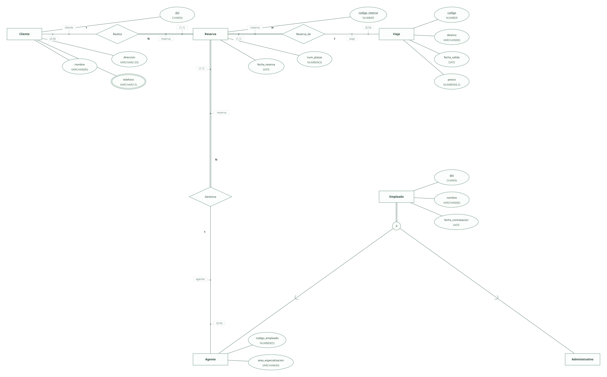
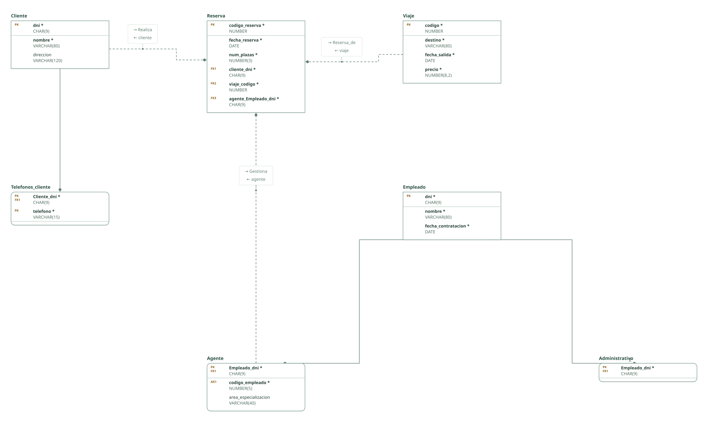

# Agencia de viajes · ejercicio 1 (guion ERE)

Proyecto de DataBasic. Escribe aquí la semántica del diseño: una entrada por línea que empieza por «- », y al final, entre _(paréntesis)_, el elemento al que se refiere. Al abrir la carpeta, DataBasic lee estas tres secciones; las tablas y las filas las toma de `esquema.sql`.

## Semántica del enunciado

- Los viajes se identifican por un código único. _(Entidad Viaje)_
- Un agente gestiona muchas reservas y cada reserva la gestiona un único agente. _(Relación Gestiona)_

## Supuestos semánticos

- La reserva es una entidad con código propio: tiene atributos y participa en Gestiona, cosa que una relación Cliente–Viaje no podría hacer sin agregación. _(Entidad Reserva)_
- Los teléfonos del cliente son un atributo multivaluado. _(Entidad Cliente)_
- Todo empleado es agente o administrativo, nunca ambos: especialización total y disjunta. _(Entidad Empleado)_
- El código de empleado del agente es único: clave alternativa. _(Entidad Agente)_

## Semántica perdida

- Que las plazas reservadas de un viaje no superen su capacidad no se puede expresar (el enunciado no da la capacidad). _(Entidad Reserva)_

<!-- DataBasic: lo que sigue se escribe al guardar; al abrir solo se leen los supuestos de arriba. -->

## Diagrama entidad-relación

## Modelo relacional

## Archivos de la carpeta

| Archivo | Contenido |
| --- | --- |
| `README.md` | La semántica del diseño: enunciado, supuestos y semántica perdida. Manda en los supuestos. |
| `esquema.sql` | Tablas, claves, relaciones, consultas y filas en el SQL de DataBasic. Manda en tablas y datos. |
| `proyecto.databasic.json` | Lo que el SQL no dice: diagrama entidad-relación, posiciones, colores, cardinalidades, diseño físico y formularios. |
| `diagrama.svg` | Diagrama entidad-relación, como imagen. |
| `relacional.svg` | Modelo relacional, como imagen. |

Al guardar desde DataBasic se escriben también: `relacional.vdx`, `base_de_datos.bas`, `base_de_datos.sql`, `base_de_datos.xml`.

## Tablas

| Tabla | Campos | Clave principal | Filas |
| --- | ---: | --- | ---: |
| Cliente | 3 | dni | 8 |
| Telefonos_cliente | 2 | Cliente_dni, telefono | 8 |
| Reserva | 6 | codigo_reserva | 8 |
| Viaje | 4 | codigo | 8 |
| Empleado | 3 | dni | 8 |
| Agente | 3 | Empleado_dni | 4 |
| Administrativo | 1 | Empleado_dni | 4 |

Para abrir la carpeta: DataBasic → Archivo → Abrir, y elige el .zip, la carpeta o el enlace de GitHub.
