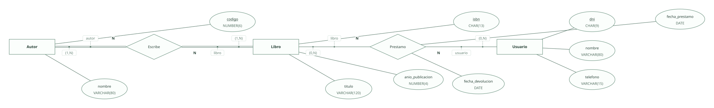
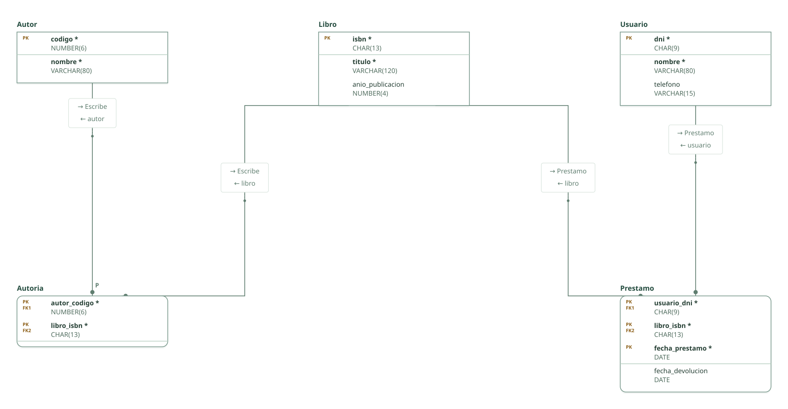

# Biblioteca · mini-ejercicio 2 (Tema 2)

Proyecto de DataBasic. Escribe aquí la semántica del diseño: una entrada por línea que empieza por «- », y al final, entre _(paréntesis)_, el elemento al que se refiere. Al abrir la carpeta, DataBasic lee estas tres secciones; las tablas y las filas las toma de `esquema.sql`.

## Semántica del enunciado

- Entidades: libros, autores y usuarios. Relaciones: un autor escribe libros y un usuario toma libros en préstamo. _(Entidad Libro)_

## Supuestos semánticos

- Un libro tiene uno o varios autores y un autor escribe uno o varios libros: N:N. _(Relación Escribe)_
- El préstamo guarda las fechas; la de préstamo forma parte de la clave para que un usuario pueda volver a tomar el mismo libro. _(Relación Prestamo)_

## Semántica perdida

- Se presta el libro, no un ejemplar concreto: con varios ejemplares haría falta la entidad débil Ejemplar. _(Relación Prestamo)_
- Que un mismo libro no esté prestado a dos usuarios a la vez no se impone con claves. _(Relación Prestamo)_

<!-- DataBasic: lo que sigue se escribe al guardar; al abrir solo se leen los supuestos de arriba. -->

## Diagrama entidad-relación

## Modelo relacional

## Archivos de la carpeta

| Archivo | Contenido |
| --- | --- |
| `README.md` | La semántica del diseño: enunciado, supuestos y semántica perdida. Manda en los supuestos. |
| `esquema.sql` | Tablas, claves, relaciones, consultas y filas en el SQL de DataBasic. Manda en tablas y datos. |
| `proyecto.databasic.json` | Lo que el SQL no dice: diagrama entidad-relación, posiciones, colores, cardinalidades, diseño físico y formularios. |
| `diagrama.svg` | Diagrama entidad-relación, como imagen. |
| `relacional.svg` | Modelo relacional, como imagen. |

Al guardar desde DataBasic se escriben también: `relacional.vdx`, `base_de_datos.bas`, `base_de_datos.sql`, `base_de_datos.xml`.

## Tablas

| Tabla | Campos | Clave principal | Filas |
| --- | ---: | --- | ---: |
| Autor | 2 | codigo | 8 |
| Libro | 3 | isbn | 8 |
| Usuario | 3 | dni | 8 |
| Autoria | 2 | autor_codigo, libro_isbn | 8 |
| Prestamo | 4 | usuario_dni, libro_isbn, fecha_prestamo | 8 |

Para abrir la carpeta: DataBasic → Archivo → Abrir, y elige el .zip, la carpeta o el enlace de GitHub.
