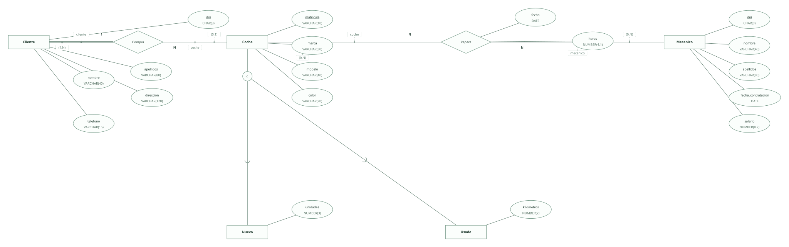
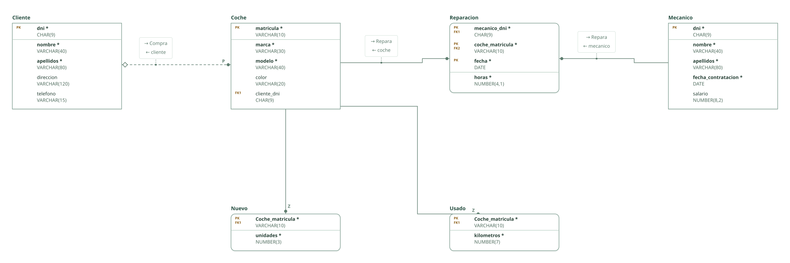

# Concesionario · ejercicio 7 (Tema 2)

Proyecto de DataBasic. Escribe aquí la semántica del diseño: una entrada por línea que empieza por «- », y al final, entre _(paréntesis)_, el elemento al que se refiere. Al abrir la carpeta, DataBasic lee estas tres secciones; las tablas y las filas las toma de `esquema.sql`.

## Semántica del enunciado

- Los coches que el concesionario vende son nuevos o usados, con sus datos propios: especialización disjunta. _(Entidad Coche)_
- Un mecánico repara varios coches y un coche lo reparan varios mecánicos; se guarda la fecha y las horas. _(Relación Repara)_

## Supuestos semánticos

- La especialización es parcial: los coches de clientes que llegan al taller sin haberse vendido aquí se registran solo como Coche. _(Entidad Coche)_
- La fecha forma parte de la clave de la reparación: el mismo mecánico puede reparar el mismo coche en días distintos. _(Relación Repara)_
- Un coche aún no vendido, o que solo pasa por el taller, no tiene comprador: la clave ajena al cliente admite nulos. _(Relación Compra)_
- El cliente solo se registra cuando compra: participación (1,N) en Compra. _(Entidad Cliente)_
- Las unidades de un coche nuevo se leen como las existencias de ese mismo modelo en el concesionario, como pide el apartado d; un diseño más fino separaría una entidad Modelo. _(Entidad Nuevo)_

## Semántica perdida

- Que un coche no esté a la vez en Nuevo y en Usado (especialización disjunta) no lo imponen las claves. _(Entidad Coche)_

<!-- DataBasic: lo que sigue se escribe al guardar; al abrir solo se leen los supuestos de arriba. -->

## Diagrama entidad-relación

## Modelo relacional

## Archivos de la carpeta

| Archivo | Contenido |
| --- | --- |
| `README.md` | La semántica del diseño: enunciado, supuestos y semántica perdida. Manda en los supuestos. |
| `esquema.sql` | Tablas, claves, relaciones, consultas y filas en el SQL de DataBasic. Manda en tablas y datos. |
| `proyecto.databasic.json` | Lo que el SQL no dice: diagrama entidad-relación, posiciones, colores, cardinalidades, diseño físico y formularios. |
| `diagrama.svg` | Diagrama entidad-relación, como imagen. |
| `relacional.svg` | Modelo relacional, como imagen. |

Al guardar desde DataBasic se escriben también: `relacional.vdx`, `base_de_datos.bas`, `base_de_datos.sql`, `base_de_datos.xml`.

## Tablas

| Tabla | Campos | Clave principal | Filas |
| --- | ---: | --- | ---: |
| Cliente | 5 | dni | 8 |
| Coche | 5 | matricula | 8 |
| Nuevo | 2 | Coche_matricula | 3 |
| Usado | 2 | Coche_matricula | 3 |
| Mecanico | 5 | dni | 8 |
| Reparacion | 4 | mecanico_dni, coche_matricula, fecha | 8 |

Para abrir la carpeta: DataBasic → Archivo → Abrir, y elige el .zip, la carpeta o el enlace de GitHub.
