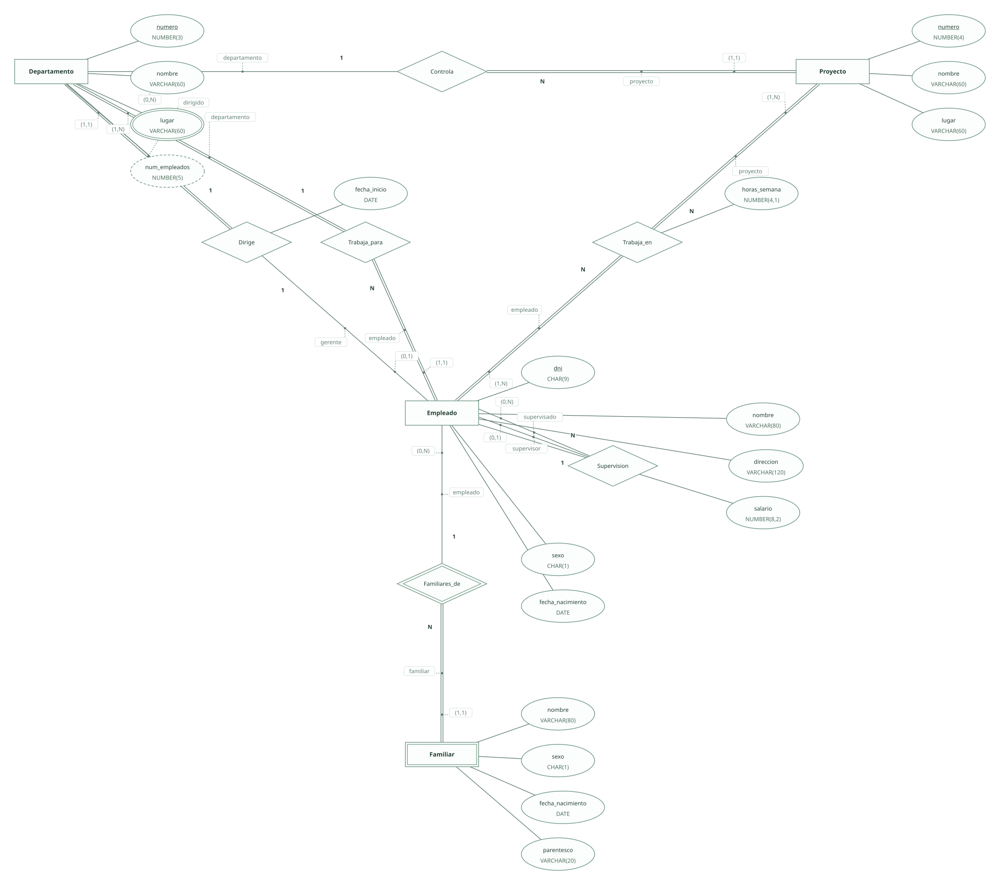
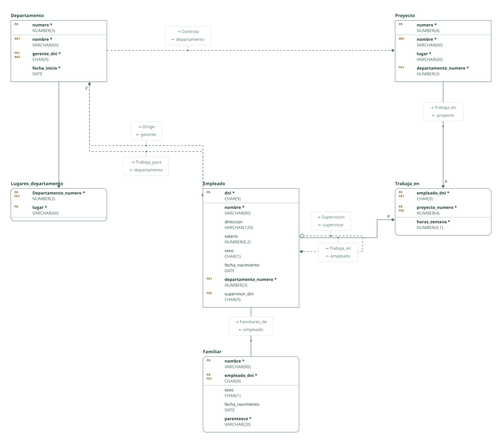

# Empresa · ejercicio 2 (guion ERE)

Proyecto de DataBasic. Escribe aquí la semántica del diseño: una entrada por línea que empieza por «- », y al final, entre _(paréntesis)_, el elemento al que se refiere. Al abrir la carpeta, DataBasic lee estas tres secciones; las tablas y las filas las toma de `esquema.sql`.

## Semántica del enunciado

- Departamento y proyecto tienen nombre y número únicos: el número es la clave primaria y el nombre una clave alternativa. _(Entidad Departamento)_
- Un departamento puede estar en varios lugares: atributo multivaluado; un proyecto, en uno solo. _(Entidad Departamento)_
- Participaciones del apartado b: Dirige total para el departamento, Trabaja_para total en ambos lados, Controla total para el proyecto, Supervision parcial en ambos, Trabaja_en total en ambos y Familiares_de total para el familiar. _(Relación Trabaja_en)_
- Apartado c: la fecha en que el jefe empieza a dirigir es un atributo de Dirige y viaja a la tabla Departamento. _(Relación Dirige)_
- Dirige es 1:1: la clave ajena del gerente en Departamento es además clave alternativa, así que un empleado dirige como mucho un departamento. _(Relación Dirige)_

## Supuestos semánticos

- El número total de empleados del departamento es un atributo derivado: se calcula contando Trabaja_para y no se almacena. _(Entidad Departamento)_
- El familiar se identifica por su nombre dentro de cada empleado: entidad débil con clave parcial. _(Entidad Familiar)_

## Semántica perdida

- La participación total del departamento en Trabaja_para y de ambos lados en Trabaja_en no se impone con claves ajenas. _(Relación Trabaja_en)_
- Que el gerente trabaje en el departamento que dirige, y que nadie se supervise a sí mismo, quedan fuera de las claves. _(Relación Dirige)_

<!-- DataBasic: lo que sigue se escribe al guardar; al abrir solo se leen los supuestos de arriba. -->

## Diagrama entidad-relación

## Modelo relacional

## Archivos de la carpeta

| Archivo | Contenido |
| --- | --- |
| `README.md` | La semántica del diseño: enunciado, supuestos y semántica perdida. Manda en los supuestos. |
| `esquema.sql` | Tablas, claves, relaciones, consultas y filas en el SQL de DataBasic. Manda en tablas y datos. |
| `proyecto.databasic.json` | Lo que el SQL no dice: diagrama entidad-relación, posiciones, colores, cardinalidades, diseño físico y formularios. |
| `diagrama.svg` | Diagrama entidad-relación, como imagen. |
| `relacional.svg` | Modelo relacional, como imagen. |

Al guardar desde DataBasic se escriben también: `relacional.vdx`, `base_de_datos.bas`, `base_de_datos.sql`, `base_de_datos.xml`.

## Tablas

| Tabla | Campos | Clave principal | Filas |
| --- | ---: | --- | ---: |
| Departamento | 4 | numero | 8 |
| Lugares_departamento | 2 | Departamento_numero, lugar | 8 |
| Proyecto | 4 | numero | 8 |
| Empleado | 8 | dni | 8 |
| Familiar | 5 | nombre, empleado_dni | 8 |
| Trabaja_en | 3 | empleado_dni, proyecto_numero | 8 |

Para abrir la carpeta: DataBasic → Archivo → Abrir, y elige el .zip, la carpeta o el enlace de GitHub.
