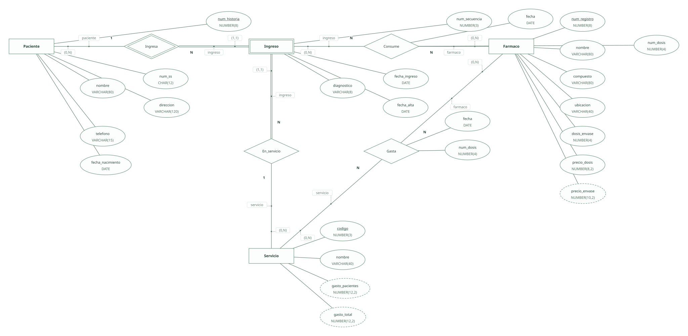
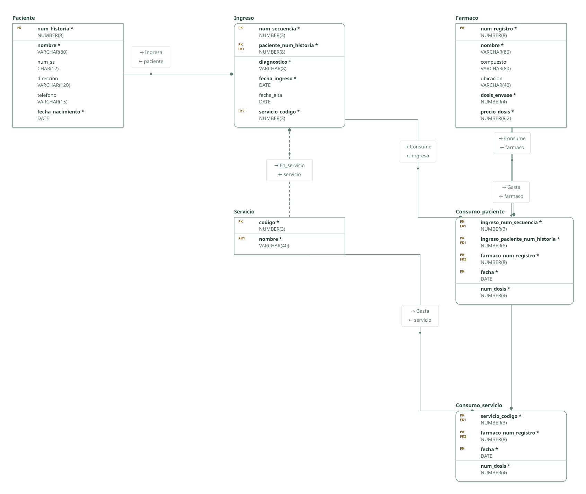

# Hospital: consumo de fármacos · ejercicio 6 (guion ERE)

Proyecto de DataBasic. Escribe aquí la semántica del diseño: una entrada por línea que empieza por «- », y al final, entre _(paréntesis)_, el elemento al que se refiere. Al abrir la carpeta, DataBasic lee estas tres secciones; las tablas y las filas las toma de `esquema.sql`.

## Semántica del enunciado

- El paciente se identifica por su número de historia clínica; cada ingreso, por un número de secuencia dentro de ella. _(Entidad Ingreso)_
- Hay consumos por paciente (de un ingreso) y consumos generales de cada servicio con su fecha. _(Relación Gasta)_
- El precio total por envase se obtiene de las dosis por envase y el precio por dosis: atributo derivado que no se almacena. _(Entidad Farmaco)_
- Apartado f: el gasto de los pacientes de cada servicio y el total del servicio se calculan a partir de los consumos: atributos derivados de Servicio que no se almacenan. _(Entidad Servicio)_

## Supuestos semánticos

- El servicio se identifica por un código; su nombre es único. _(Entidad Servicio)_
- El consumo de un paciente también lleva fecha, que forma parte de la clave: el mismo fármaco puede darse en días distintos del ingreso. _(Relación Consume)_
- El número de la Seguridad Social es opcional («si lo tuviera»): no es clave alternativa, que exigiría valor, sino un índice sin duplicados que admite pacientes sin número. _(Entidad Paciente)_
- El diagnóstico se registra codificado (por ejemplo, con la clasificación CIE-10) para poder agrupar los informes por diagnóstico. _(Entidad Ingreso)_

## Semántica perdida

- Los informes de gasto por paciente, servicio o diagnóstico y los atributos derivados de Servicio son consultas sobre estas tablas: no se guardan ni se comprueban. _(Entidad Servicio)_

<!-- DataBasic: lo que sigue se escribe al guardar; al abrir solo se leen los supuestos de arriba. -->

## Diagrama entidad-relación

## Modelo relacional

## Archivos de la carpeta

| Archivo | Contenido |
| --- | --- |
| `README.md` | La semántica del diseño: enunciado, supuestos y semántica perdida. Manda en los supuestos. |
| `esquema.sql` | Tablas, claves, relaciones, consultas y filas en el SQL de DataBasic. Manda en tablas y datos. |
| `proyecto.databasic.json` | Lo que el SQL no dice: diagrama entidad-relación, posiciones, colores, cardinalidades, diseño físico y formularios. |
| `diagrama.svg` | Diagrama entidad-relación, como imagen. |
| `relacional.svg` | Modelo relacional, como imagen. |

Al guardar desde DataBasic se escriben también: `relacional.vdx`, `base_de_datos.bas`, `base_de_datos.sql`, `base_de_datos.xml`.

## Tablas

| Tabla | Campos | Clave principal | Filas |
| --- | ---: | --- | ---: |
| Paciente | 6 | num_historia | 8 |
| Ingreso | 6 | num_secuencia, paciente_num_historia | 8 |
| Servicio | 2 | codigo | 8 |
| Farmaco | 6 | num_registro | 8 |
| Consumo_paciente | 5 | ingreso_num_secuencia, ingreso_paciente_num_historia, farmaco_num_registro, fecha | 8 |
| Consumo_servicio | 4 | servicio_codigo, farmaco_num_registro, fecha | 8 |

Para abrir la carpeta: DataBasic → Archivo → Abrir, y elige el .zip, la carpeta o el enlace de GitHub.
