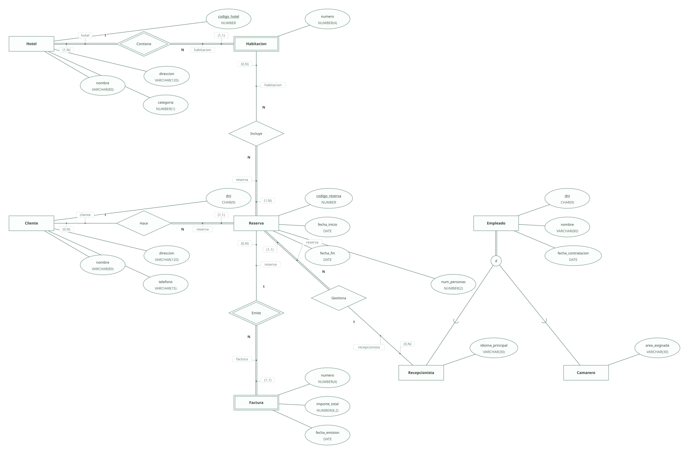
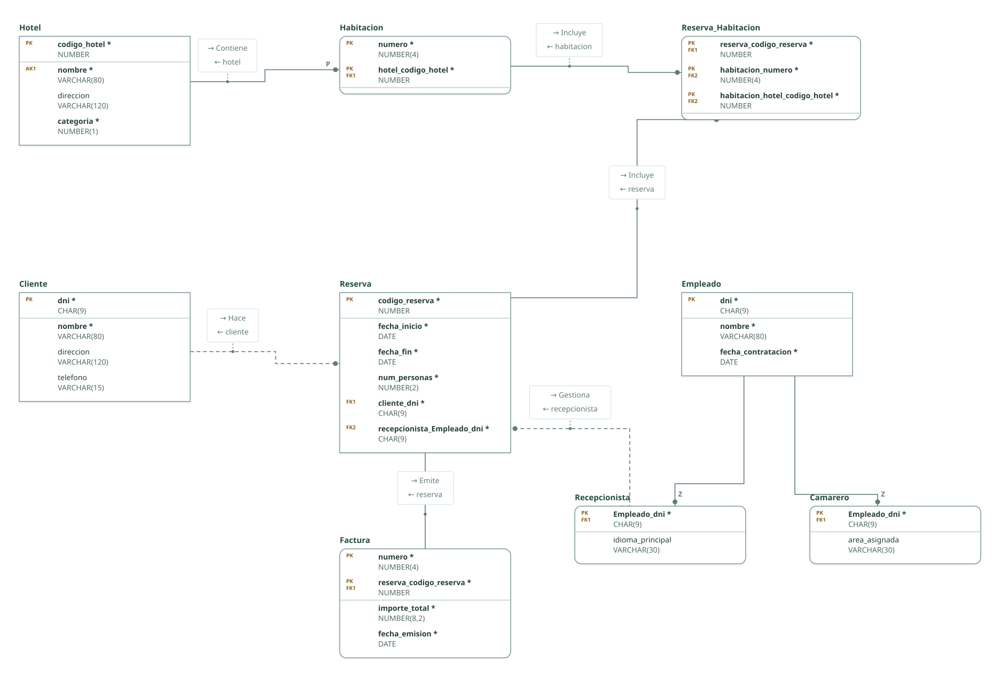

# Cadena hotelera · ejercicio 3 (guion ERE)

Proyecto de DataBasic. Escribe aquí la semántica del diseño: una entrada por línea que empieza por «- », y al final, entre _(paréntesis)_, el elemento al que se refiere. Al abrir la carpeta, DataBasic lee estas tres secciones; las tablas y las filas las toma de `esquema.sql`.

## Semántica del enunciado

- Cada hotel tiene un nombre único: clave alternativa sobre el nombre. _(Entidad Hotel)_
- Las habitaciones se identifican por su número dentro de cada hotel: entidad débil con clave parcial. _(Entidad Habitacion)_
- La factura se identifica por un número correlativo dentro de la reserva: entidad débil de Reserva. _(Entidad Factura)_

## Supuestos semánticos

- Se añade un código de reserva porque el enunciado no identifica las reservas. _(Entidad Reserva)_
- Una habitación puede aparecer en varias reservas en intervalos distintos; la relación es N:N. _(Relación Incluye)_
- Todo empleado es recepcionista o camarero: clasificación total y disjunta. _(Entidad Empleado)_

## Semántica perdida

- Que dos reservas no solapen fechas sobre la misma habitación no se expresa con claves; queda como restricción documental. _(Relación Incluye)_
- Que la categoría sea de 1 a 5 estrellas y que la fecha de fin no preceda a la de inicio quedan como dominios (CHECK). _(Entidad Reserva)_

<!-- DataBasic: lo que sigue se escribe al guardar; al abrir solo se leen los supuestos de arriba. -->

## Diagrama entidad-relación

## Modelo relacional

## Archivos de la carpeta

| Archivo | Contenido |
| --- | --- |
| `README.md` | La semántica del diseño: enunciado, supuestos y semántica perdida. Manda en los supuestos. |
| `esquema.sql` | Tablas, claves, relaciones, consultas y filas en el SQL de DataBasic. Manda en tablas y datos. |
| `proyecto.databasic.json` | Lo que el SQL no dice: diagrama entidad-relación, posiciones, colores, cardinalidades, diseño físico y formularios. |
| `diagrama.svg` | Diagrama entidad-relación, como imagen. |
| `relacional.svg` | Modelo relacional, como imagen. |

Al guardar desde DataBasic se escriben también: `relacional.vdx`, `base_de_datos.bas`, `base_de_datos.sql`, `base_de_datos.xml`.

## Tablas

| Tabla | Campos | Clave principal | Filas |
| --- | ---: | --- | ---: |
| Hotel | 4 | codigo_hotel | 8 |
| Habitacion | 2 | numero, hotel_codigo_hotel | 8 |
| Cliente | 4 | dni | 8 |
| Reserva | 6 | codigo_reserva | 8 |
| Factura | 4 | numero, reserva_codigo_reserva | 8 |
| Empleado | 3 | dni | 8 |
| Recepcionista | 2 | Empleado_dni | 4 |
| Camarero | 2 | Empleado_dni | 4 |
| Reserva_Habitacion | 3 | reserva_codigo_reserva, habitacion_numero, habitacion_hotel_codigo_hotel | 8 |

Para abrir la carpeta: DataBasic → Archivo → Abrir, y elige el .zip, la carpeta o el enlace de GitHub.
