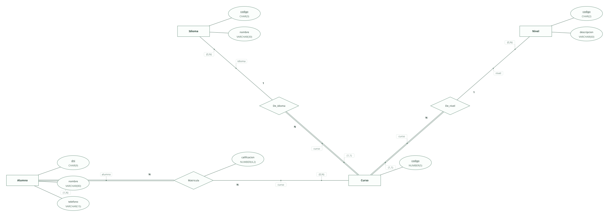
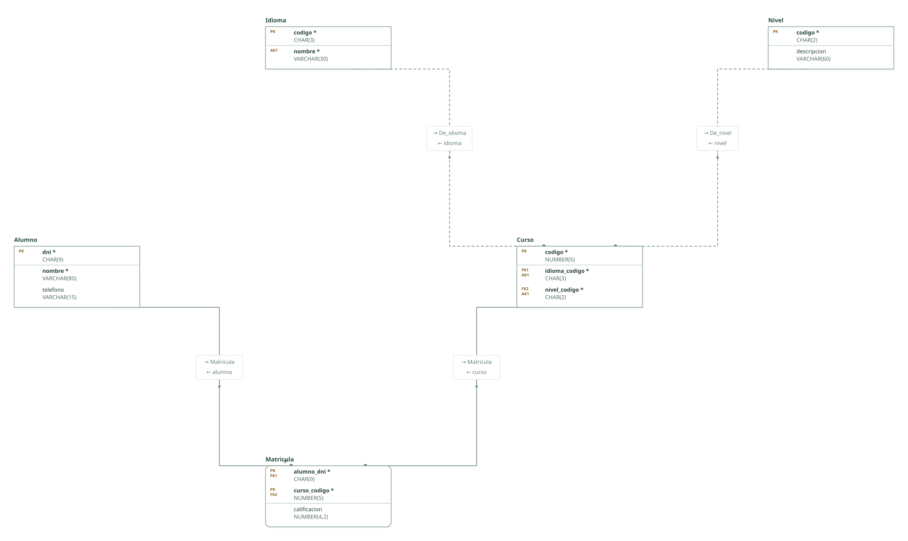

# Escuela de idiomas · ejercicio 1 (Tema 2)

Proyecto de DataBasic. Escribe aquí la semántica del diseño: una entrada por línea que empieza por «- », y al final, entre _(paréntesis)_, el elemento al que se refiere. Al abrir la carpeta, DataBasic lee estas tres secciones; las tablas y las filas las toma de `esquema.sql`.

## Semántica del enunciado

- Un mismo nivel puede existir para idiomas distintos y la escuela no oferta todos los niveles de todos los idiomas. _(Entidad Curso)_

## Supuestos semánticos

- Cada combinación ofertada de idioma y nivel es un Curso con código propio; la pareja idioma–nivel es clave alternativa para no repetirla. _(Entidad Curso)_
- El alumno se matricula en cursos, no en idiomas y niveles sueltos; la calificación es un atributo de la matrícula. _(Relación Matricula)_
- Un alumno se matricula al menos de un curso. _(Entidad Alumno)_

## Semántica perdida

- Si un alumno repite curso en años distintos haría falta el año en la clave de la matrícula; el enunciado no lo pide. _(Relación Matricula)_

<!-- DataBasic: lo que sigue se escribe al guardar; al abrir solo se leen los supuestos de arriba. -->

## Diagrama entidad-relación

## Modelo relacional

## Archivos de la carpeta

| Archivo | Contenido |
| --- | --- |
| `README.md` | La semántica del diseño: enunciado, supuestos y semántica perdida. Manda en los supuestos. |
| `esquema.sql` | Tablas, claves, relaciones, consultas y filas en el SQL de DataBasic. Manda en tablas y datos. |
| `proyecto.databasic.json` | Lo que el SQL no dice: diagrama entidad-relación, posiciones, colores, cardinalidades, diseño físico y formularios. |
| `diagrama.svg` | Diagrama entidad-relación, como imagen. |
| `relacional.svg` | Modelo relacional, como imagen. |

Al guardar desde DataBasic se escriben también: `relacional.vdx`, `base_de_datos.bas`, `base_de_datos.sql`, `base_de_datos.xml`.

## Tablas

| Tabla | Campos | Clave principal | Filas |
| --- | ---: | --- | ---: |
| Alumno | 3 | dni | 8 |
| Idioma | 2 | codigo | 8 |
| Nivel | 2 | codigo | 8 |
| Curso | 3 | codigo | 8 |
| Matricula | 3 | alumno_dni, curso_codigo | 8 |

Para abrir la carpeta: DataBasic → Archivo → Abrir, y elige el .zip, la carpeta o el enlace de GitHub.
