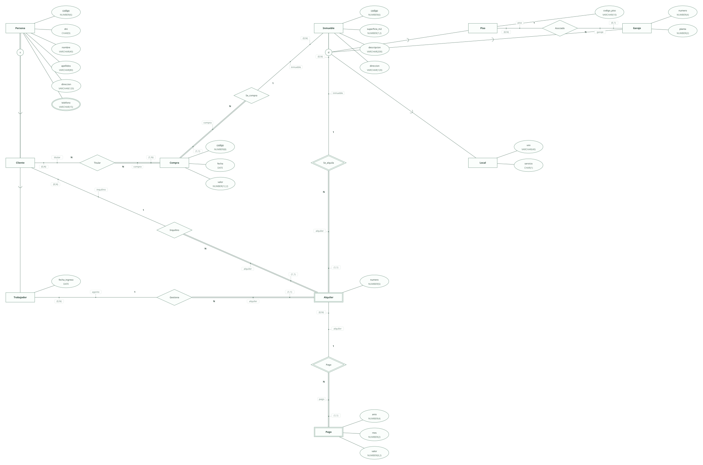
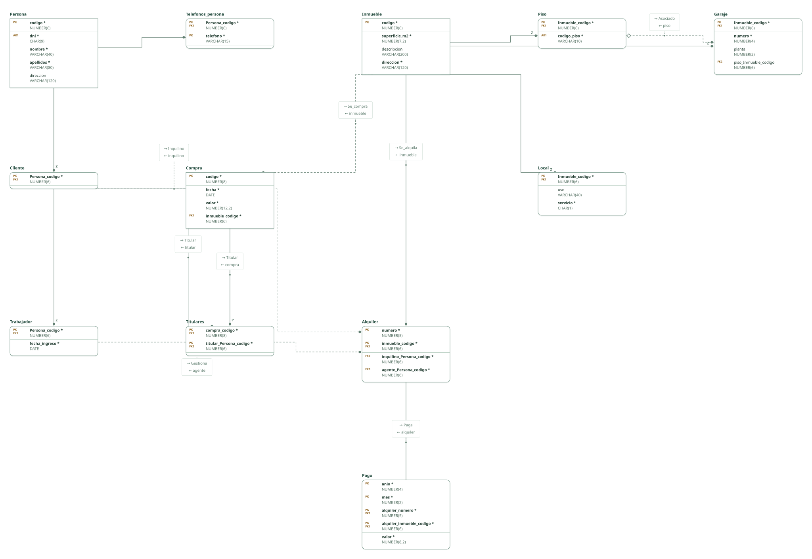

# Inmobiliaria · ejercicio 5 (guion ERE)

Proyecto de DataBasic. Escribe aquí la semántica del diseño: una entrada por línea que empieza por «- », y al final, entre _(paréntesis)_, el elemento al que se refiere. Al abrir la carpeta, DataBasic lee estas tres secciones; las tablas y las filas las toma de `esquema.sql`.

## Semántica del enunciado

- Clientes y trabajadores comparten datos y un código personal, y un trabajador puede ser también cliente: especialización solapada de Persona. _(Entidad Persona)_
- Puede haber inmuebles que no sean ni pisos, ni locales, ni garajes: especialización parcial y disjunta de Inmueble. _(Entidad Inmueble)_
- El número de alquiler se repite entre inmuebles pero no en el mismo: Alquiler es entidad débil de Inmueble. _(Entidad Alquiler)_
- Cada pago de un alquiler se identifica por su año y mes: Pago es entidad débil de Alquiler. _(Entidad Pago)_
- Una compra puede tener varios titulares: N:N entre Compra y Cliente. _(Relación Titular)_

## Supuestos semánticos

- Todo registro de Persona es cliente, trabajador o ambos: especialización total. _(Entidad Persona)_
- El DNI es único: clave alternativa. El código de piso, también. _(Entidad Persona)_
- El agente que gestiona el alquiler es un trabajador; su nombre se obtiene de Persona. _(Relación Gestiona)_
- Un garaje se asocia como mucho a un piso, y un piso puede tener varios garajes asociados: «el garaje» se lee como cada garaje asociado al piso. Si cada piso tuviera un solo garaje, Piso pasaría a (0,1) y la clave ajena del garaje sería única. _(Relación Asociado)_

## Semántica perdida

- Que al alquilar un piso se incluya su garaje es un comportamiento de la aplicación, no una restricción del modelo. _(Relación Asociado)_
- Que el número de garaje no se repita dentro de un mismo edificio no se puede expresar: no hay entidad Edificio. _(Entidad Garaje)_

<!-- DataBasic: lo que sigue se escribe al guardar; al abrir solo se leen los supuestos de arriba. -->

## Diagrama entidad-relación

## Modelo relacional

## Archivos de la carpeta

| Archivo | Contenido |
| --- | --- |
| `README.md` | La semántica del diseño: enunciado, supuestos y semántica perdida. Manda en los supuestos. |
| `esquema.sql` | Tablas, claves, relaciones, consultas y filas en el SQL de DataBasic. Manda en tablas y datos. |
| `proyecto.databasic.json` | Lo que el SQL no dice: diagrama entidad-relación, posiciones, colores, cardinalidades, diseño físico y formularios. |
| `diagrama.svg` | Diagrama entidad-relación, como imagen. |
| `relacional.svg` | Modelo relacional, como imagen. |

Al guardar desde DataBasic se escriben también: `relacional.vdx`, `base_de_datos.bas`, `base_de_datos.sql`, `base_de_datos.xml`.

## Tablas

| Tabla | Campos | Clave principal | Filas |
| --- | ---: | --- | ---: |
| Persona | 5 | codigo | 8 |
| Telefonos_persona | 2 | Persona_codigo, telefono | 8 |
| Cliente | 1 | Persona_codigo | 5 |
| Trabajador | 2 | Persona_codigo | 5 |
| Inmueble | 4 | codigo | 8 |
| Piso | 2 | Inmueble_codigo | 2 |
| Local | 3 | Inmueble_codigo | 2 |
| Garaje | 4 | Inmueble_codigo | 2 |
| Compra | 4 | codigo | 8 |
| Alquiler | 4 | numero, inmueble_codigo | 8 |
| Pago | 5 | anio, mes, alquiler_numero, alquiler_inmueble_codigo | 8 |
| Titulares | 2 | compra_codigo, titular_Persona_codigo | 8 |

Para abrir la carpeta: DataBasic → Archivo → Abrir, y elige el .zip, la carpeta o el enlace de GitHub.
