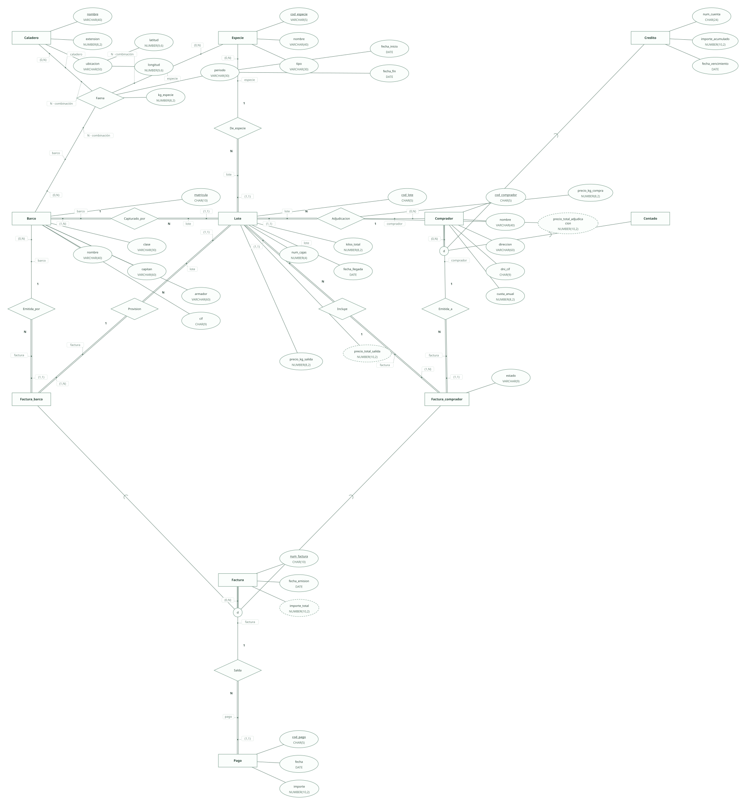
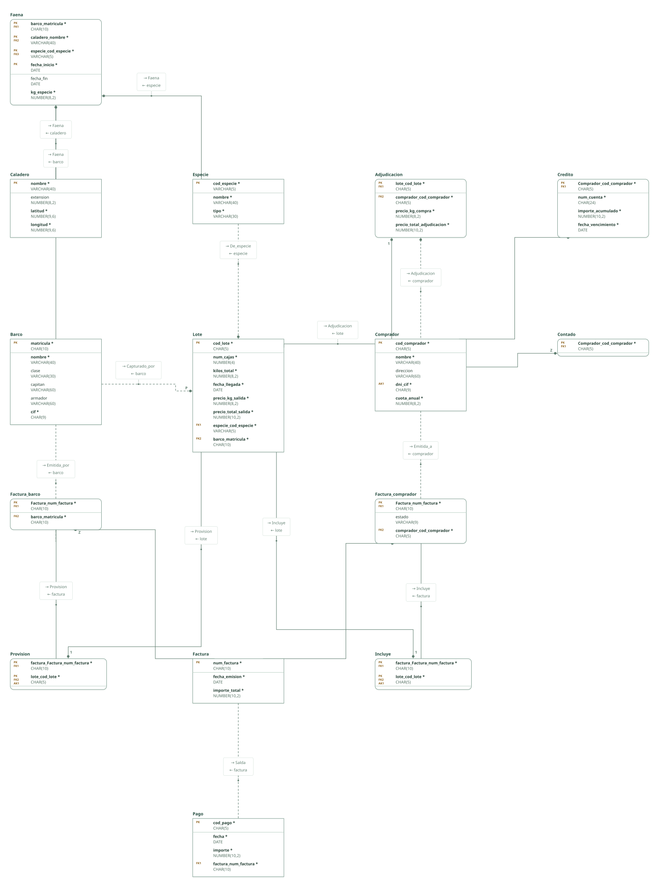

# Lonja de Santa Pola · práctica 1 (2025-2026)

Proyecto de DataBasic. Escribe aquí la semántica del diseño: una entrada por línea que empieza por «- », y al final, entre _(paréntesis)_, el elemento al que se refiere. Al abrir la carpeta, DataBasic lee estas tres secciones; las tablas y las filas las toma de `esquema.sql`.

## Semántica del enunciado

- Cada lote tiene un código único, es de una sola especie y lo capturó un barco. _(Entidad Lote)_
- La relación ternaria es Faena: qué barcos capturan qué especies en qué caladeros, con los kilos y el periodo (fecha de inicio y de fin). _(Relación Faena)_
- Un comprador es de crédito o de contado, nunca ambos: especialización disjunta. Como todo comprador es de uno de los dos tipos, es total. _(Entidad Comprador)_
- Las facturas de los barcos guardan "además de los datos mencionados de la factura" su barco y sus lotes: generalización Factura con lo común (número, fecha, importe) y dos subclases. _(Entidad Factura)_
- Solo las facturas a compradores sin crédito necesitan el estado (pendiente o pagada). _(Entidad Factura_comprador)_
- De la adjudicación se guardan el precio de compra por kilo y el precio total de adjudicación. _(Relación Adjudicacion)_

## Supuestos semánticos

- El número de factura es el registro que asigna la lonja, único para todas las facturas que guarda, también las recibidas de los barcos. _(Entidad Factura)_
- Los precios totales y el importe de la factura son derivados (se calculan de kilos, precios y lotes), pero se guardan porque el enunciado pide conocerlos y guardarlos. _(Entidad Lote)_
- La fecha de inicio forma parte de la clave de Faena: el mismo barco puede faenar la misma especie en el mismo caladero en periodos distintos. _(Relación Faena)_
- No se guardan las pujas, solo la adjudicación ganadora; guardar todas encarecería el sistema sin uso posterior. Debería confirmarlo el cliente. _(Relación Adjudicacion)_
- El CIF del barco se guarda en Barco y la factura del barco lo obtiene por su relación, sin repetirlo. _(Entidad Barco)_
- El número de cuenta bancaria es un IBAN y se guarda como CHAR(24) porque lleva letras de país. _(Entidad Credito)_
- Contado no tiene atributos propios: su tabla solo guarda la clave. Alternativa válida: omitirla y entender que paga al contado quien no está en Credito; ahorra una tabla pero la cobertura total deja de verse. _(Entidad Contado)_
- Cada pago salda una factura, sea del barco (pago de la lonja) o del comprador (cobro); el tipo de factura dice quién paga. Un comprador con crédito registra al final de mes un pago por cada factura. _(Relación Salda)_
- Incluye y Provision son tablas propias para que un lote pueda existir antes de facturarse; la clave alternativa sobre el lote impide que esté en dos facturas. _(Relación Incluye)_

## Semántica perdida

- Las pujas no se registran: solo queda la ganadora. _(Relación Adjudicacion)_
- Adjudicación, Incluye y Provision están en tablas aparte: un lote sin adjudicar o sin facturar no aparece en ellas, así que su participación total (1,1) no se impone. _(Relación Adjudicacion)_
- Que los valores derivados guardados coincidan con su cálculo no lo impone ninguna clave. _(Entidad Lote)_
- Que el estado solo se use en facturas de compradores al contado, y que los lotes de una factura sean los adjudicados a su comprador o capturados por su barco, no se impone con claves. _(Entidad Factura_comprador)_
- Que cada comprador esté exactamente en Credito o en Contado (disjunta y total) no lo imponen las claves primarias y ajenas. _(Entidad Comprador)_
- Que la especie de un lote sea una de las que su barco faena no lo impone ninguna clave ajena. _(Relación De_especie)_

<!-- DataBasic: lo que sigue se escribe al guardar; al abrir solo se leen los supuestos de arriba. -->

## Diagrama entidad-relación

## Modelo relacional

## Archivos de la carpeta

| Archivo | Contenido |
| --- | --- |
| `README.md` | La semántica del diseño: enunciado, supuestos y semántica perdida. Manda en los supuestos. |
| `esquema.sql` | Tablas, claves, relaciones, consultas y filas en el SQL de DataBasic. Manda en tablas y datos. |
| `proyecto.databasic.json` | Lo que el SQL no dice: diagrama entidad-relación, posiciones, colores, cardinalidades, diseño físico y formularios. |
| `diagrama.svg` | Diagrama entidad-relación, como imagen. |
| `relacional.svg` | Modelo relacional, como imagen. |

Al guardar desde DataBasic se escriben también: `relacional.vdx`, `base_de_datos.bas`, `base_de_datos.sql`, `base_de_datos.xml`.

## Tablas

| Tabla | Campos | Clave principal | Filas |
| --- | ---: | --- | ---: |
| Caladero | 4 | nombre | 8 |
| Especie | 3 | cod_especie | 8 |
| Barco | 6 | matricula | 8 |
| Lote | 8 | cod_lote | 8 |
| Comprador | 5 | cod_comprador | 8 |
| Credito | 4 | Comprador_cod_comprador | 4 |
| Contado | 1 | Comprador_cod_comprador | 4 |
| Factura | 3 | num_factura | 8 |
| Factura_barco | 2 | Factura_num_factura | 4 |
| Factura_comprador | 3 | Factura_num_factura | 4 |
| Pago | 4 | cod_pago | 8 |
| Faena | 6 | barco_matricula, caladero_nombre, especie_cod_especie, fecha_inicio | 8 |
| Adjudicacion | 4 | lote_cod_lote | 8 |
| Incluye | 2 | factura_Factura_num_factura, lote_cod_lote | 8 |
| Provision | 2 | factura_Factura_num_factura, lote_cod_lote | 8 |

Para abrir la carpeta: DataBasic → Archivo → Abrir, y elige el .zip, la carpeta o el enlace de GitHub.
