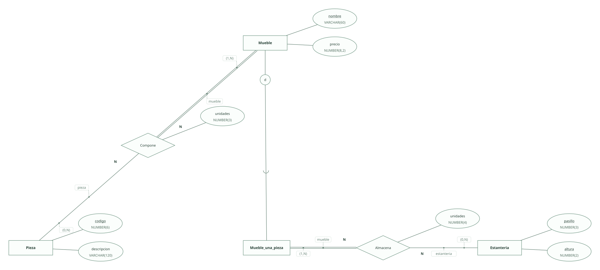
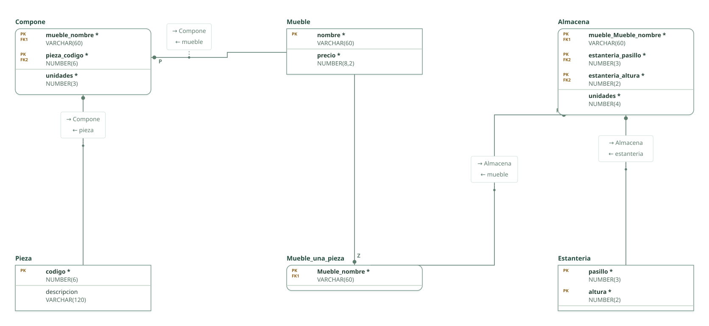

# Taller de muebles · ejercicio 4 (Tema 2)

Proyecto de DataBasic. Escribe aquí la semántica del diseño: una entrada por línea que empieza por «- », y al final, entre _(paréntesis)_, el elemento al que se refiere. Al abrir la carpeta, DataBasic lee estas tres secciones; las tablas y las filas las toma de `esquema.sql`.

## Semántica del enunciado

- Una pieza forma parte de varios muebles y un mueble está formado por una o más piezas, con las unidades de cada una. _(Relación Compone)_
- La estantería se identifica por pasillo y altura: clave compuesta. _(Entidad Estanteria)_
- Los muebles de una sola pieza se encuentran en una o más estanterías: subclase Mueble_una_pieza (especialización parcial de Mueble) con participación (1,N) en Almacena. _(Entidad Mueble_una_pieza)_

## Supuestos semánticos

- Una pieza puede estar en el catálogo sin formar parte todavía de ningún mueble: participación (0,N) en Compone. _(Entidad Pieza)_
- Una estantería puede estar vacía: participación (0,N) en Almacena. _(Entidad Estanteria)_
- Las unidades valen al menos 1: si un mueble no tiene unidades en una estantería, no hay fila en Almacena. _(Relación Almacena)_

## Semántica perdida

- Que Mueble_una_pieza contenga exactamente los muebles con una sola pieza depende de contar sus filas en Compone: no se impone con claves. _(Entidad Mueble_una_pieza)_

<!-- DataBasic: lo que sigue se escribe al guardar; al abrir solo se leen los supuestos de arriba. -->

## Diagrama entidad-relación

## Modelo relacional

## Archivos de la carpeta

| Archivo | Contenido |
| --- | --- |
| `README.md` | La semántica del diseño: enunciado, supuestos y semántica perdida. Manda en los supuestos. |
| `esquema.sql` | Tablas, claves, relaciones, consultas y filas en el SQL de DataBasic. Manda en tablas y datos. |
| `proyecto.databasic.json` | Lo que el SQL no dice: diagrama entidad-relación, posiciones, colores, cardinalidades, diseño físico y formularios. |
| `diagrama.svg` | Diagrama entidad-relación, como imagen. |
| `relacional.svg` | Modelo relacional, como imagen. |

Al guardar desde DataBasic se escriben también: `relacional.vdx`, `base_de_datos.bas`, `base_de_datos.sql`, `base_de_datos.xml`.

## Tablas

| Tabla | Campos | Clave principal | Filas |
| --- | ---: | --- | ---: |
| Mueble | 2 | nombre | 8 |
| Pieza | 2 | codigo | 8 |
| Mueble_una_pieza | 1 | Mueble_nombre | 6 |
| Estanteria | 2 | pasillo, altura | 8 |
| Compone | 3 | mueble_nombre, pieza_codigo | 8 |
| Almacena | 4 | mueble_Mueble_nombre, estanteria_pasillo, estanteria_altura | 8 |

Para abrir la carpeta: DataBasic → Archivo → Abrir, y elige el .zip, la carpeta o el enlace de GitHub.
