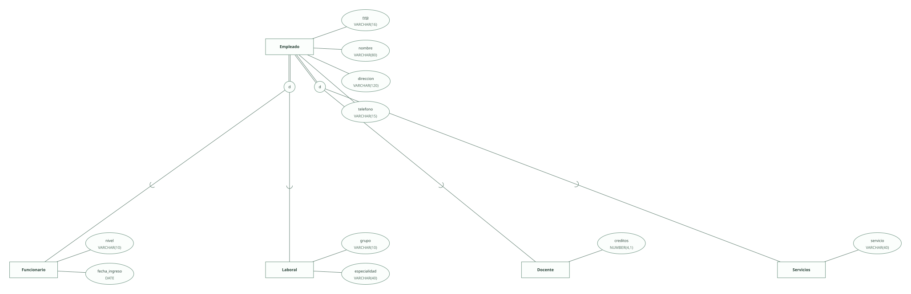
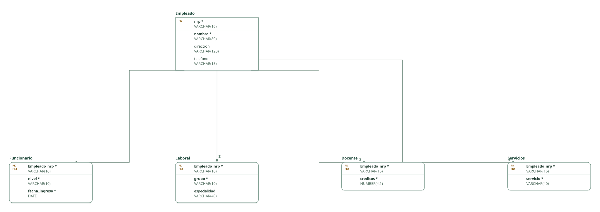

# Funcionarios y contratados · ejercicio 2 (Tema 2)

Proyecto de DataBasic. Escribe aquí la semántica del diseño: una entrada por línea que empieza por «- », y al final, entre _(paréntesis)_, el elemento al que se refiere. Al abrir la carpeta, DataBasic lee estas tres secciones; las tablas y las filas las toma de `esquema.sql`.

## Semántica del enunciado

- Hay dos clasificaciones independientes del mismo empleado: por su vínculo (funcionario o laboral) y por su función (docencia o servicios). _(Entidad Empleado)_

## Supuestos semánticos

- Cada clasificación es total y disjunta: todo empleado tiene exactamente un vínculo y exactamente una función. _(Entidad Empleado)_
- El NRP es un código de registro con letras y cifras, no una cantidad: se guarda como texto (VARCHAR). _(Entidad Empleado)_

## Semántica perdida

- Que cada empleado aparezca en una y solo una subtabla de cada clasificación no lo imponen las claves ajenas; queda documentado. _(Entidad Empleado)_

<!-- DataBasic: lo que sigue se escribe al guardar; al abrir solo se leen los supuestos de arriba. -->

## Diagrama entidad-relación

## Modelo relacional

## Archivos de la carpeta

| Archivo | Contenido |
| --- | --- |
| `README.md` | La semántica del diseño: enunciado, supuestos y semántica perdida. Manda en los supuestos. |
| `esquema.sql` | Tablas, claves, relaciones, consultas y filas en el SQL de DataBasic. Manda en tablas y datos. |
| `proyecto.databasic.json` | Lo que el SQL no dice: diagrama entidad-relación, posiciones, colores, cardinalidades, diseño físico y formularios. |
| `diagrama.svg` | Diagrama entidad-relación, como imagen. |
| `relacional.svg` | Modelo relacional, como imagen. |

Al guardar desde DataBasic se escriben también: `relacional.vdx`, `base_de_datos.bas`, `base_de_datos.sql`, `base_de_datos.xml`.

## Tablas

| Tabla | Campos | Clave principal | Filas |
| --- | ---: | --- | ---: |
| Empleado | 4 | nrp | 8 |
| Funcionario | 3 | Empleado_nrp | 4 |
| Laboral | 3 | Empleado_nrp | 4 |
| Docente | 2 | Empleado_nrp | 4 |
| Servicios | 2 | Empleado_nrp | 4 |

Para abrir la carpeta: DataBasic → Archivo → Abrir, y elige el .zip, la carpeta o el enlace de GitHub.
