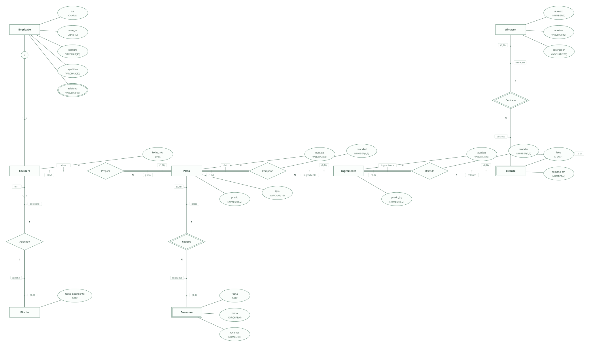
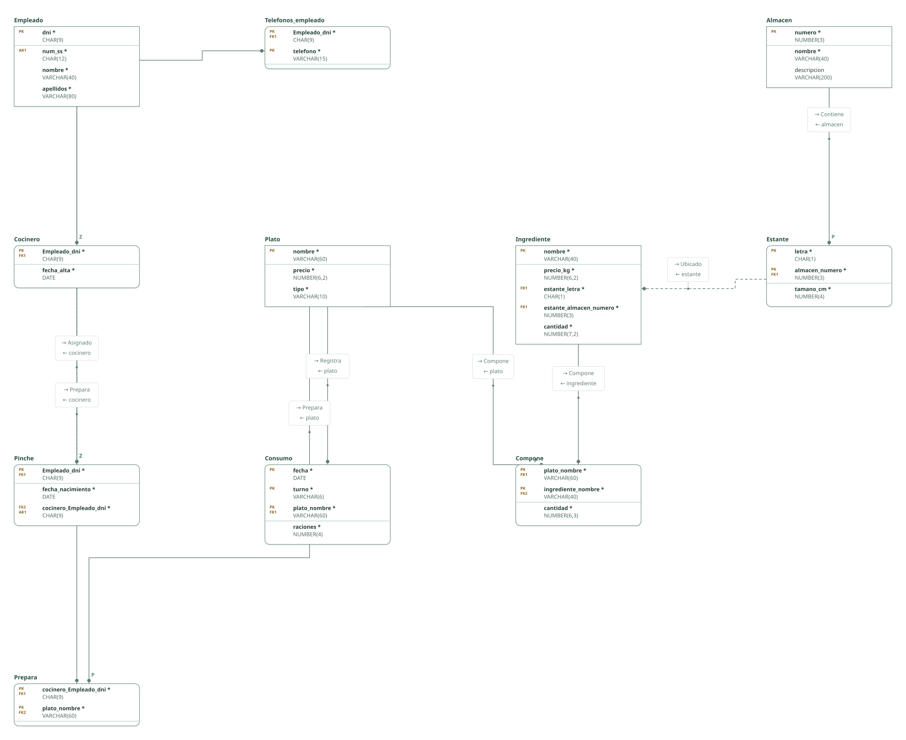

# Restaurante · ejercicio 4 (guion ERE)

Proyecto de DataBasic. Escribe aquí la semántica del diseño: una entrada por línea que empieza por «- », y al final, entre _(paréntesis)_, el elemento al que se refiere. Al abrir la carpeta, DataBasic lee estas tres secciones; las tablas y las filas las toma de `esquema.sql`.

## Semántica del enunciado

- El número de la Seguridad Social es único: clave alternativa. Los teléfonos son un atributo multivaluado. _(Entidad Empleado)_
- Los estantes se nombran con letras de la A a la Z dentro de cada almacén: entidad débil de Almacen. _(Entidad Estante)_
- Un ingrediente está en un solo estante y un estante guarda varios; la cantidad guardada es un atributo de la relación. _(Relación Ubicado)_
- Un cocinero tiene como máximo un pinche y todo pinche tiene su cocinero: 1:1 con la clave ajena en Pinche, única. _(Relación Asignado)_
- Prepara registra la especialidad: «solamente pueden preparar ellos» se cumple porque solo los cocineros relacionados con un plato en Prepara lo preparan. _(Relación Prepara)_

## Supuestos semánticos

- Los empleados comunes no tienen atributos propios: son los que no están en ninguna subclase. Especialización parcial y disjunta. _(Entidad Empleado)_
- El tipo de plato es un dominio y no una especialización, porque los tipos no tienen atributos propios. _(Entidad Plato)_
- Prepara es N:N porque el enunciado pide «qué cocineros preparan cada plato»: varios cocineros pueden compartir especialidad y un cocinero prepara varios platos. _(Relación Prepara)_
- El consumo diario es una entidad débil del plato identificada por fecha y turno (comida o cena), con el número de raciones. _(Entidad Consumo)_
- La letra del estante se limita a la lista A–Z como dominio. _(Entidad Estante)_

## Semántica perdida

- Que todo plato tenga al menos un cocinero que lo prepare no se impone con claves: nada obliga a que el plato aparezca en Prepara. _(Relación Prepara)_

<!-- DataBasic: lo que sigue se escribe al guardar; al abrir solo se leen los supuestos de arriba. -->

## Diagrama entidad-relación

## Modelo relacional

## Archivos de la carpeta

| Archivo | Contenido |
| --- | --- |
| `README.md` | La semántica del diseño: enunciado, supuestos y semántica perdida. Manda en los supuestos. |
| `esquema.sql` | Tablas, claves, relaciones, consultas y filas en el SQL de DataBasic. Manda en tablas y datos. |
| `proyecto.databasic.json` | Lo que el SQL no dice: diagrama entidad-relación, posiciones, colores, cardinalidades, diseño físico y formularios. |
| `diagrama.svg` | Diagrama entidad-relación, como imagen. |
| `relacional.svg` | Modelo relacional, como imagen. |

Al guardar desde DataBasic se escriben también: `relacional.vdx`, `base_de_datos.bas`, `base_de_datos.sql`, `base_de_datos.xml`.

## Tablas

| Tabla | Campos | Clave principal | Filas |
| --- | ---: | --- | ---: |
| Empleado | 4 | dni | 8 |
| Telefonos_empleado | 2 | Empleado_dni, telefono | 8 |
| Cocinero | 2 | Empleado_dni | 3 |
| Pinche | 3 | Empleado_dni | 3 |
| Plato | 3 | nombre | 8 |
| Ingrediente | 5 | nombre | 8 |
| Almacen | 3 | numero | 8 |
| Estante | 3 | letra, almacen_numero | 8 |
| Consumo | 4 | fecha, turno, plato_nombre | 8 |
| Compone | 3 | plato_nombre, ingrediente_nombre | 8 |
| Prepara | 2 | cocinero_Empleado_dni, plato_nombre | 8 |

Para abrir la carpeta: DataBasic → Archivo → Abrir, y elige el .zip, la carpeta o el enlace de GitHub.
