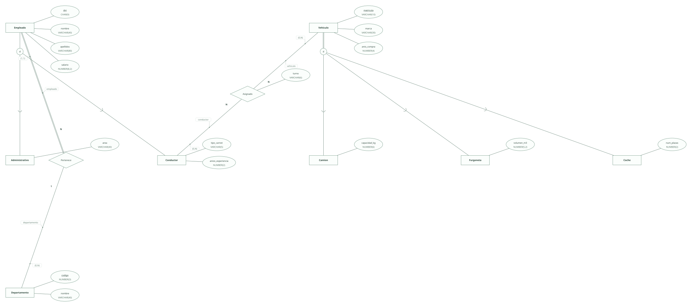
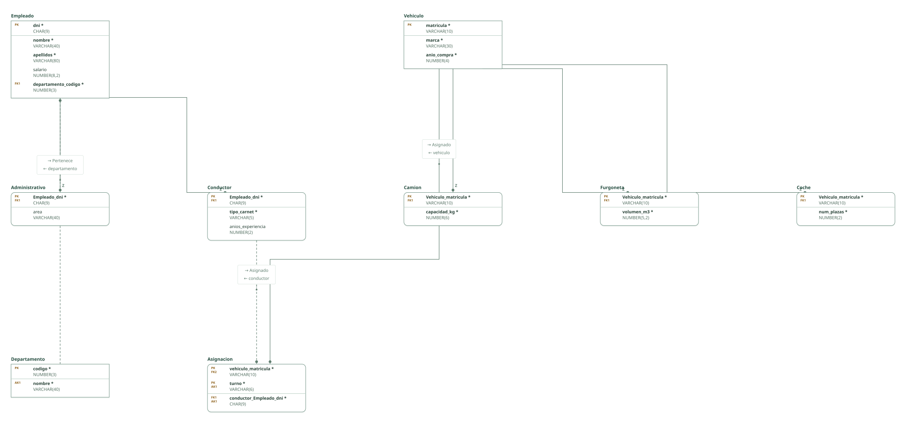

# Empresa de transporte · ejercicio 6 (Tema 2)

Proyecto de DataBasic. Escribe aquí la semántica del diseño: una entrada por línea que empieza por «- », y al final, entre _(paréntesis)_, el elemento al que se refiere. Al abrir la carpeta, DataBasic lee estas tres secciones; las tablas y las filas las toma de `esquema.sql`.

## Semántica del enunciado

- Todos los vehículos son camión, furgoneta o coche de empresa, cada uno con su dato propio: especialización total y disjunta. _(Entidad Vehiculo)_
- Todo empleado pertenece obligatoriamente a un departamento, cuyo nombre no se repite. _(Relación Pertenece)_
- Un vehículo lo usan conductores distintos en turnos distintos: en cada turno tiene un solo conductor, así que la clave de la asignación es (vehículo, turno) y el conductor es una clave ajena obligatoria fuera de la clave. _(Relación Asignado)_

## Supuestos semánticos

- Los empleados "pueden ser" conductores o administrativos: especialización parcial y disjunta. _(Entidad Empleado)_
- Un conductor lleva un solo vehículo en cada turno: clave alternativa (conductor, turno). _(Relación Asignado)_
- Los turnos (mañana, tarde, noche) son un horario fijo que se repite cada día; si la asignación cambiara de un día a otro, la fecha entraría en la clave. _(Relación Asignado)_

## Semántica perdida

- Que todo vehículo sea exactamente de un tipo (especialización total y disjunta) no lo imponen las claves: un vehículo podría quedar sin subtabla o en dos. _(Entidad Vehiculo)_

<!-- DataBasic: lo que sigue se escribe al guardar; al abrir solo se leen los supuestos de arriba. -->

## Diagrama entidad-relación

## Modelo relacional

## Archivos de la carpeta

| Archivo | Contenido |
| --- | --- |
| `README.md` | La semántica del diseño: enunciado, supuestos y semántica perdida. Manda en los supuestos. |
| `esquema.sql` | Tablas, claves, relaciones, consultas y filas en el SQL de DataBasic. Manda en tablas y datos. |
| `proyecto.databasic.json` | Lo que el SQL no dice: diagrama entidad-relación, posiciones, colores, cardinalidades, diseño físico y formularios. |
| `diagrama.svg` | Diagrama entidad-relación, como imagen. |
| `relacional.svg` | Modelo relacional, como imagen. |

Al guardar desde DataBasic se escriben también: `relacional.vdx`, `base_de_datos.bas`, `base_de_datos.sql`, `base_de_datos.xml`.

## Tablas

| Tabla | Campos | Clave principal | Filas |
| --- | ---: | --- | ---: |
| Vehiculo | 3 | matricula | 8 |
| Camion | 2 | Vehiculo_matricula | 3 |
| Furgoneta | 2 | Vehiculo_matricula | 3 |
| Coche | 2 | Vehiculo_matricula | 2 |
| Empleado | 5 | dni | 8 |
| Conductor | 3 | Empleado_dni | 3 |
| Administrativo | 2 | Empleado_dni | 3 |
| Departamento | 2 | codigo | 8 |
| Asignacion | 3 | vehiculo_matricula, turno | 8 |

Para abrir la carpeta: DataBasic → Archivo → Abrir, y elige el .zip, la carpeta o el enlace de GitHub.
