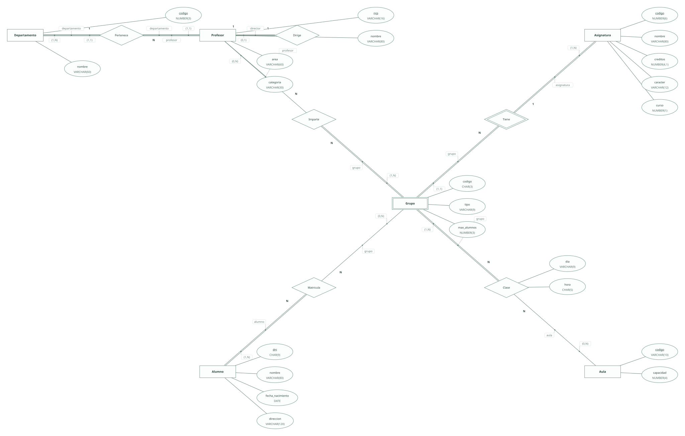
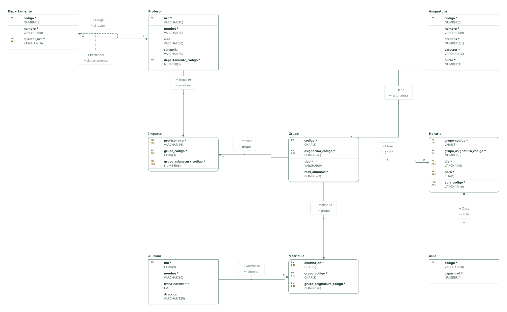

# Gestión universitaria · ejercicio 8 (Tema 2)

Proyecto de DataBasic. Escribe aquí la semántica del diseño: una entrada por línea que empieza por «- », y al final, entre _(paréntesis)_, el elemento al que se refiere. Al abrir la carpeta, DataBasic lee estas tres secciones; las tablas y las filas las toma de `esquema.sql`.

## Semántica del enunciado

- Un profesor pertenece a un solo departamento y todo departamento tiene un director, que es un profesor. _(Relación Dirige)_
- Un grupo lo imparte al menos un profesor y un profesor imparte varios grupos. _(Relación Imparte)_
- A los grupos se les imparten clases en días, horas y aulas determinadas: todo grupo participa en Clase (1,N). _(Relación Clase)_
- Los alumnos se matriculan de varias asignaturas (al menos una), siempre en un grupo: Matricula N:N entre Alumno (1,N) y Grupo. _(Relación Matricula)_

## Supuestos semánticos

- El grupo se identifica por su código dentro de la asignatura: entidad débil de Asignatura. _(Entidad Grupo)_
- Teoría y prácticas no tienen atributos propios: el tipo de grupo es un dominio, no una especialización. _(Entidad Grupo)_
- Las clases se dan en un día de la semana y una hora; ambos forman parte de la clave del horario. _(Relación Clase)_
- Un grupo está en una sola aula a la vez y un aula acoge un solo grupo a la vez: la clave de Horario es (grupo, día, hora), el aula es una clave ajena obligatoria fuera de la clave y (aula, día, hora) es clave alternativa. _(Relación Clase)_
- El número de registro personal es un código con letras y cifras: se guarda como texto (VARCHAR). _(Entidad Profesor)_

## Semántica perdida

- Que el alumno esté en un solo grupo por asignatura no se impone: con la clave (alumno, grupo) una restricción UNIQUE (alumno, asignatura) dejaría la clave primaria sin ser mínima. El diseño que sí lo impone es Matricula(alumno, asignatura, grupo) con clave (alumno, asignatura); si hubiera grupos de teoría y de prácticas, la regla sería uno por asignatura y tipo. _(Relación Matricula)_
- Que el grupo no supere su máximo de alumnos ni la capacidad del aula, y que el director pertenezca a su departamento, no se imponen con claves. _(Relación Matricula)_
- Departamento y Profesor se referencian mutuamente con claves ajenas obligatorias: al cargar datos hay que insertar uno con la referencia pendiente. _(Relación Dirige)_

<!-- DataBasic: lo que sigue se escribe al guardar; al abrir solo se leen los supuestos de arriba. -->

## Diagrama entidad-relación

## Modelo relacional

## Archivos de la carpeta

| Archivo | Contenido |
| --- | --- |
| `README.md` | La semántica del diseño: enunciado, supuestos y semántica perdida. Manda en los supuestos. |
| `esquema.sql` | Tablas, claves, relaciones, consultas y filas en el SQL de DataBasic. Manda en tablas y datos. |
| `proyecto.databasic.json` | Lo que el SQL no dice: diagrama entidad-relación, posiciones, colores, cardinalidades, diseño físico y formularios. |
| `diagrama.svg` | Diagrama entidad-relación, como imagen. |
| `relacional.svg` | Modelo relacional, como imagen. |

Al guardar desde DataBasic se escriben también: `relacional.vdx`, `base_de_datos.bas`, `base_de_datos.sql`, `base_de_datos.xml`.

## Tablas

| Tabla | Campos | Clave principal | Filas |
| --- | ---: | --- | ---: |
| Departamento | 3 | codigo | 8 |
| Profesor | 5 | nrp | 8 |
| Asignatura | 5 | codigo | 8 |
| Grupo | 4 | codigo, asignatura_codigo | 8 |
| Aula | 2 | codigo | 8 |
| Alumno | 4 | dni | 8 |
| Imparte | 3 | profesor_nrp, grupo_codigo, grupo_asignatura_codigo | 8 |
| Horario | 5 | grupo_codigo, grupo_asignatura_codigo, dia, hora | 8 |
| Matricula | 3 | alumno_dni, grupo_codigo, grupo_asignatura_codigo | 8 |

Para abrir la carpeta: DataBasic → Archivo → Abrir, y elige el .zip, la carpeta o el enlace de GitHub.
