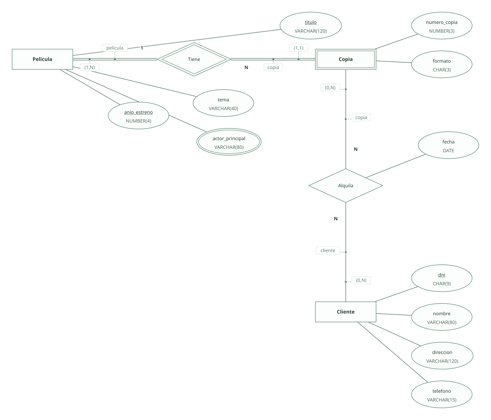
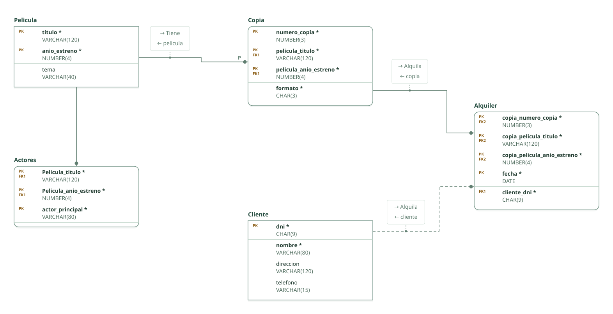

# Videoclub · ejercicio 3 (Tema 2)

Proyecto de DataBasic. Escribe aquí la semántica del diseño: una entrada por línea que empieza por «- », y al final, entre _(paréntesis)_, el elemento al que se refiere. Al abrir la carpeta, DataBasic lee estas tres secciones; las tablas y las filas las toma de `esquema.sql`.

## Semántica del enunciado

- Puede haber películas con igual título pero distinto año: la clave es (título, año de estreno). _(Entidad Pelicula)_
- Las copias se numeran dentro de cada película: entidad débil con clave parcial. _(Entidad Copia)_
- Un cliente puede realizar varios alquileres en un día: el cliente no forma parte de la clave, así que puede repetirse con la misma fecha. _(Relación Alquila)_

## Supuestos semánticos

- Los actores principales se guardan como atributo multivaluado, traducido a la tabla Actores. _(Entidad Pelicula)_
- Una misma copia se alquila como mucho una vez al día: la clave del alquiler es (copia, fecha) y el cliente es una clave ajena obligatoria fuera de la clave. _(Relación Alquila)_

## Semántica perdida

- La devolución del alquiler no figura en el enunciado y no se modela. _(Relación Alquila)_

<!-- DataBasic: lo que sigue se escribe al guardar; al abrir solo se leen los supuestos de arriba. -->

## Diagrama entidad-relación

## Modelo relacional

## Archivos de la carpeta

| Archivo | Contenido |
| --- | --- |
| `README.md` | La semántica del diseño: enunciado, supuestos y semántica perdida. Manda en los supuestos. |
| `esquema.sql` | Tablas, claves, relaciones, consultas y filas en el SQL de DataBasic. Manda en tablas y datos. |
| `proyecto.databasic.json` | Lo que el SQL no dice: diagrama entidad-relación, posiciones, colores, cardinalidades, diseño físico y formularios. |
| `diagrama.svg` | Diagrama entidad-relación, como imagen. |
| `relacional.svg` | Modelo relacional, como imagen. |

Al guardar desde DataBasic se escriben también: `relacional.vdx`, `base_de_datos.bas`, `base_de_datos.sql`, `base_de_datos.xml`.

## Tablas

| Tabla | Campos | Clave principal | Filas |
| --- | ---: | --- | ---: |
| Pelicula | 3 | titulo, anio_estreno | 8 |
| Actores | 3 | Pelicula_titulo, Pelicula_anio_estreno, actor_principal | 8 |
| Copia | 4 | numero_copia, pelicula_titulo, pelicula_anio_estreno | 8 |
| Cliente | 4 | dni | 8 |
| Alquiler | 5 | copia_numero_copia, copia_pelicula_titulo, copia_pelicula_anio_estreno, fecha | 8 |

Para abrir la carpeta: DataBasic → Archivo → Abrir, y elige el .zip, la carpeta o el enlace de GitHub.
